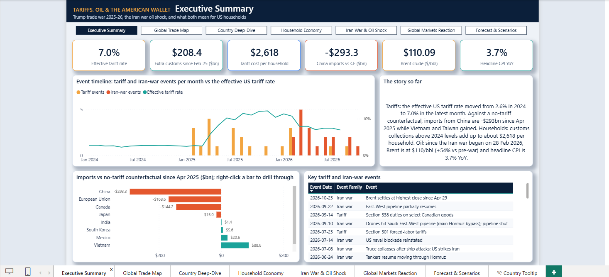
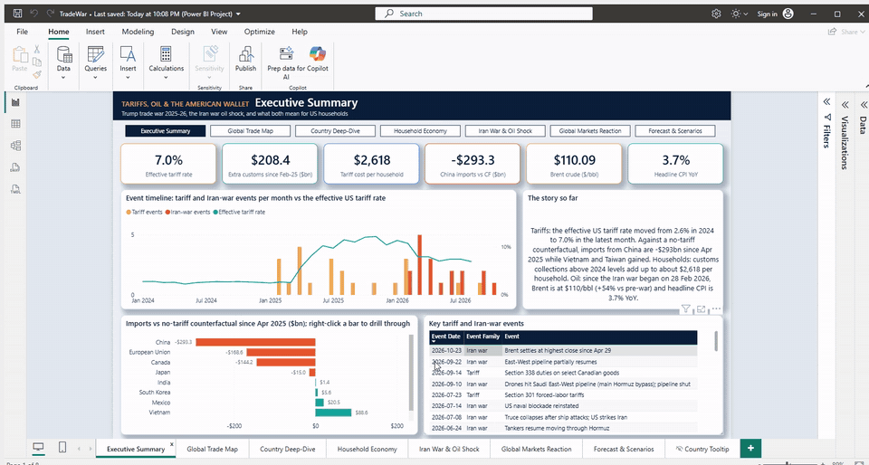
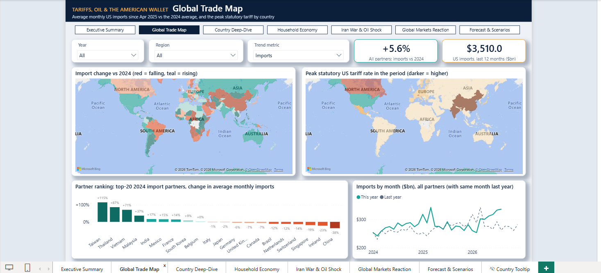
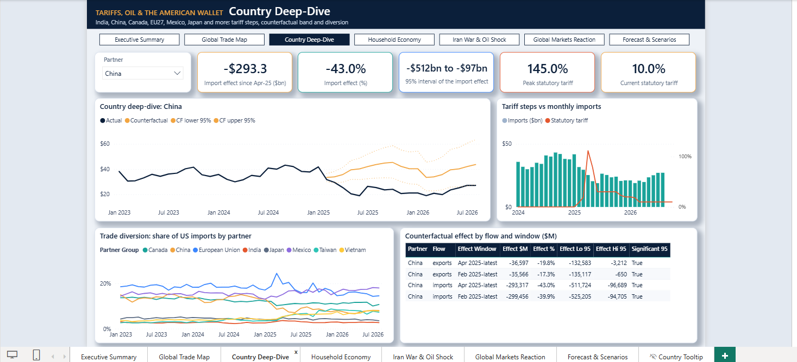
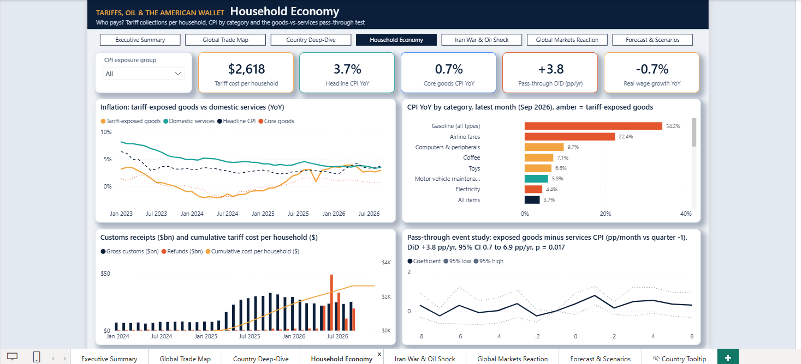
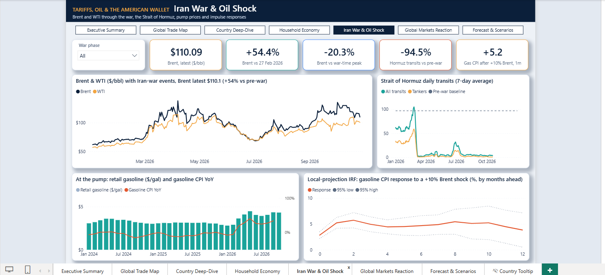
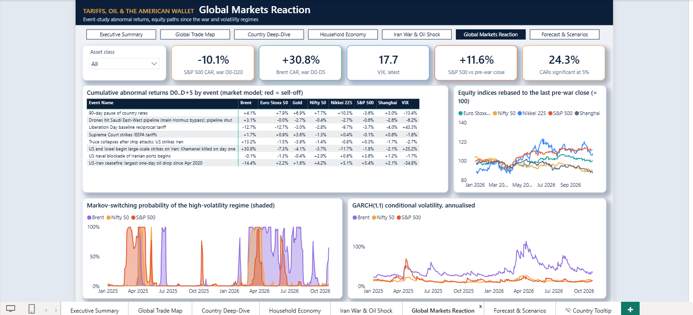
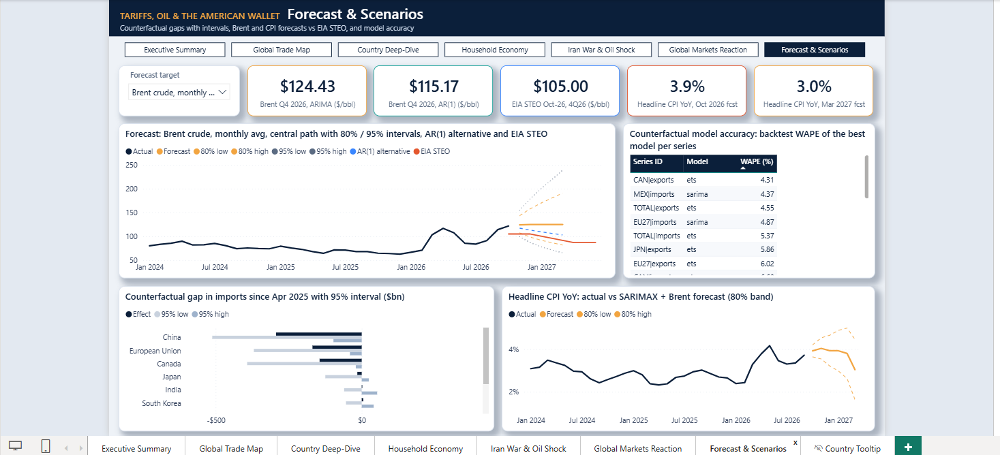
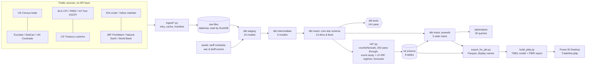

# Tariffs, Oil & the American Wallet

**How Trump's 2025-26 trade war and the 2026 Iran-war oil shock reshaped US trade, prices and markets, and what they cost the American household.**

[](https://github.com/nishanttyagi28/tariffs-oil-american-wallet/actions/workflows/ci.yml)
   -F2C811) 



<!-- DEMO: replace with the walkthrough GIF once recorded ->  -->

## The problem

Between February 2025 and late 2026 the US effective tariff rate roughly **quadrupled**, the Supreme Court struck down the IEEPA tariffs,
and a war with Iran closed the Strait of Hormuz and sent Brent crude to **$138**. Headlines argued about who pays and who wins.
This project answers those questions with **public data only** (no API keys), a tested SQL warehouse, causal and forecasting models,
and a 7-page Power BI dashboard:

- Did tariffs actually cut imports from China, India, Canada, the EU and Mexico, or did trade just move to other countries?
- How much of the tariff bill landed on US households, and did it show up in shelf prices?
- How did the Iran-war oil shock move crude, pump prices, CPI and global stock markets?
- Where are oil and inflation heading next?

## Key findings

| # | Finding | Evidence |
|---|---|---|
| 1 | **The effective US tariff rate went from 2.6% (2024 average) to a 12.2% peak (Nov 2025), and is 7.0% in the latest month (Sep 2026)** after the IEEPA ruling and refunds. | Treasury customs receipts / Census imports, SQL #14 |
| 2 | **Imports from China ran $293bn (-43%) below a "no-tariff" forecast** from Apr 2025 to Aug 2026 (95% interval -$512bn to -$97bn). | ETS counterfactual, backtest WAPE 9.9% |
| 3 | **Trade was diverted, not destroyed:** Taiwan +$167bn (+89%) and Vietnam +$89bn (+37%) above their counterfactuals; total US imports -11.6%, but that interval includes zero. India's imports showed no clear effect (+1%). | Counterfactual models, SQL #11-12 |
| 4 | **Customs collections above the 2024 run-rate add up to about $2,618 per US household** (Feb 2025 - Sep 2026). | SQL #16, Power BI page 4 |
| 5 | **Tariffs reached shelf prices:** tariff-exposed CPI goods inflated **3.8 pp/yr faster** than domestic categories (difference-in-differences, 95% CI 0.7-6.9, p = 0.017); a placebo start date shows no effect. | `ml/cpi_passthrough.py` |
| 6 | **The Iran war was a textbook oil shock:** Hormuz transits fell ~95%; Brent's abnormal return was **+30.8% in 6 trading days** (t = 6.8) and peaked at $138.21 (7 Apr 2026); the S&P 500 lost **-10.1%** abnormal over 21 days, Nifty -10.1%, Nikkei -16.9%. | Event study, PortWatch, SQL #23-28 |
| 7 | **A +10% Brent month lifts gasoline CPI ~5% within 3 months and headline CPI ~0.3% after 6 months.** | Local-projection IRFs, 2015-2026 |
| 8 | **Outlook:** ARIMA keeps Brent near $124 in Q4 2026 vs EIA STEO's $105; headline CPI is projected at 3.9% YoY (Oct 2026), easing to 3.0% by Mar 2027. | `ml/forecasts.py` |

Full write-up with every table and figure: **[docs/ml_report.md](docs/ml_report.md)**. Caveats are listed [below](#limitations--honest-caveats).

## Dashboard (Power BI, 7 pages)

| | |
|---|---|
|  |  |
| **Global Trade Map:** filled maps of import change vs 2024 and peak statutory tariff, partner ranking, YoY trend with a metric switch | **Country Deep-Dive** (drill-through): actual vs counterfactual band, tariff steps vs imports, trade diversion, effect table |
|  |  |
| **Household Economy:** tariff cost per household, CPI by category, customs receipts and refunds, pass-through event study | **Iran War & Oil Shock:** Brent/WTI, Strait of Hormuz transits, pump prices, impulse responses |
|  |  |
| **Global Markets Reaction:** abnormal-return heatmap by event, indices rebased to pre-war, Markov-switching and GARCH volatility | **Forecast & Scenarios:** Brent fan chart vs EIA, CPI forecast, counterfactual gaps, model accuracy |

- **Built as code:** the semantic model (TMDL) and report (PBIR) are generated by Python (`powerbi/build_pbip.py`) and edited in VS Code, then opened in Power BI Desktop.
- **Model:** 28 import-mode tables from Parquet, star relationships to a shared `Date` dimension, **171 DAX measures** in a `_Measures` table
  (time intelligence, "latest non-blank" patterns, measure-driven conditional colours, dynamic titles, drill-through deep-dive measures).
- **UX:** page navigator, slicers, a drill-through country page, a hidden report-page tooltip on the maps, and a custom navy/amber theme.

## Architecture



## Tech stack

| Layer | Tools |
|---|---|
| Ingestion | Python 3.12, `requests` (retry/backoff, daily cache), pandas, pyarrow |
| Warehouse | DuckDB, **dbt-core + dbt-duckdb** (staging, intermediate, marts; generic + singular tests; seeds) |
| Analysis SQL | 35 analytical queries: window functions, `QUALIFY`, pivots, rolling correlations, data-quality reconciliations |
| ML / statistics | statsmodels (ETS, SARIMA/SARIMAX, ARIMA, OLS with fixed effects, Markov switching), LightGBM, `arch` (GARCH), scikit-learn; experiments logged to `ml/experiments/*.json` |
| BI | Power BI Desktop, **PBIP** (TMDL semantic model + PBIR report), DAX |
| Quality | pytest (78 tests), dbt tests (141), ruff, PBIR JSON-schema validation, GitHub Actions CI |

## Data sources

All sources are public and downloaded without an API key by `python -m ingest.run_all`. Raw files are **not** committed; re-run the ingest to get them.

| Source | What | Link | Terms / licence |
|---|---|---|---|
| US Census Bureau | Monthly US goods trade by country | [country.xlsx](https://www.census.gov/foreign-trade/balance/country.xlsx) | US government work, public domain |
| US Treasury (Fiscal Data) | Monthly customs duties: gross, refunds, net (MTS table 4) | [api.fiscaldata.treasury.gov](https://fiscaldata.treasury.gov/datasets/monthly-treasury-statement/) | Public domain |
| BLS | CPI-U by category | [BLS Public API](https://www.bls.gov/developers/) | Public domain; API usage limits apply |
| FRED (St. Louis Fed) | Macro series (yields, USD index, wages, sentiment, import prices) | [fred.stlouisfed.org](https://fred.stlouisfed.org/) | Free; some series carry third-party copyright, see [FRED terms](https://fred.stlouisfed.org/legal/) |
| NY Fed | Global Supply Chain Pressure Index | [GSCPI](https://www.newyorkfed.org/research/policy/gscpi) | Free with attribution |
| EIA | Brent & WTI daily spot; STEO reference forecast | [eia.gov](https://www.eia.gov/dnav/pet/pet_pri_spt_s1_d.htm) | Public domain |
| Eurostat | EU27 trade with partners (monthly) | [ext_st_eu27_2020sitc](https://ec.europa.eu/eurostat/databrowser/view/ext_st_eu27_2020sitc/default/table) | CC BY 4.0 |
| Statistics Canada | Merchandise trade by partner (table 12-10-0011-01) | [StatCan](https://www150.statcan.gc.ca/t1/tbl1/en/tv.action?pid=1210001101) | [Statistics Canada Open Licence](https://www.statcan.gc.ca/en/reference/licence) |
| UN Comtrade | Mirror exports to the US (cross-check) | [comtradeplus.un.org](https://comtradeplus.un.org/) | Free public preview; [UN terms](https://comtradeplus.un.org/) |
| IMF PortWatch | Daily chokepoint transits (Strait of Hormuz etc.) | [portwatch.imf.org](https://portwatch.imf.org/) | Free with attribution to IMF PortWatch |
| Yahoo Finance | Daily indices, commodities, FX, VIX | [finance.yahoo.com](https://finance.yahoo.com/) | Personal / educational use only; not redistributed here |
| World Bank WDI | Population, GDP (annual) | [data.worldbank.org](https://data.worldbank.org/) | CC BY 4.0 |
| Natural Earth | Country codes, regions, label points | [naturalearthdata.com](https://www.naturalearthdata.com/) | Public domain |
| Hand-built seeds | Tariff schedule by country, tariff and Iran-war event timelines | [`seeds/`](seeds/) | Each row has a `source_url`; 16 of 50 tariff rows are flagged `verified = FALSE` |

`powerbi/data/*.parquet` (5.7 MB of derived, aggregated tables) is committed so the dashboard opens straight from a clone.

## SQL highlights

35 queries live in [`sql/analysis`](sql/analysis) and their outputs in [`docs/sql_outputs`](docs/sql_outputs) (run with `python sql/run_all.py`).
They cover data quality (freshness, null profiles, reconciliations), trade (rank shifts, diversion, front-loading), tariffs and household cost,
CPI pass-through, oil and Hormuz, event windows, drawdowns, rolling correlations and FX.

**Partner rank shift, 2024 vs Apr 2025+ (window function + `QUALIFY`)**
```sql
select country_name, import_rank_before, import_rank_after,
       import_rank_before - import_rank_after as rank_gain,
       round(import_share_change_pp, 2) as share_change_pp
from powerbi.mart_country_before_after
where entity_type = 'country' and import_rank_before <= 30
qualify row_number() over (order by abs(import_share_change_pp) desc) <= 20
order by import_share_change_pp desc;
```

**Cumulative tariff cost per household (running sum)**
```sql
select month_date,
       round(incremental_gross_per_household_usd, 2) as gross_per_household_usd,
       round(sum(incremental_gross_per_household_usd) over (order by month_date), 0) as cum_gross_per_household_usd
from core.fct_customs_revenue_monthly
where month_date >= date '2025-02-01'
order by month_date;
```

**Brent running peak, drawdown and the 10 biggest daily moves**
```sql
with b as (
  select obs_date, brent_usd, brent_ret,
         max(brent_usd) over (order by obs_date) as running_peak
  from core.fct_oil_daily
  where obs_date >= date '2025-01-01' and brent_usd is not null
)
select obs_date, round(brent_usd, 2) as brent_usd, round(100 * brent_ret, 2) as day_ret_pct,
       round(100 * (brent_usd / running_peak - 1), 1) as drawdown_from_peak_pct
from b
qualify row_number() over (order by abs(brent_ret) desc nulls last) <= 10
order by obs_date;
```

## ML & statistical methods

| Question | Method | Validation / metric | Result |
|---|---|---|---|
| What would trade have been without tariffs? | Per series (20 = 10 partners x imports/exports): seasonal naive vs damped ETS vs SARIMA vs global LightGBM; best model by backtest, refit to Jan 2025 | Rolling-origin backtest, 5 origins x 12 months; mean **WAPE 8.5%** (ETS) vs 10.5% naive | China imports -43%, Taiwan +89%, Vietnam +37% |
| Did tariffs raise consumer prices? | Difference-in-differences on 20 CPI categories with category + month fixed effects; event study; intensity regression | Clustered SEs, placebo start date, alternative controls | +3.8 pp/yr (p = 0.017); placebo n.s. |
| How did markets react to events? | Event study (market model / constant mean), CAR with t-stats | Shared pre-war estimation window | Brent +30.8% (D0-D5), S&P 500 -10.1% (D0-D20) |
| How does oil feed into prices? | Jorda local projections, HAC SEs | 95% bands, 0-12 months | Gasoline CPI +4.9% at 3 months per +10% Brent |
| When were markets in a crisis regime? | 2-state Markov-switching variance model + GARCH(1,1)-t | AIC vs single-regime | Brent high-vol regime 82.8% annualised vol |
| Where next? | ARIMA (log Brent) + AR(1) alternative; SARIMAX for CPI and gasoline with Brent as exogenous | 80/95% intervals; EIA STEO comparison | Brent ~$124 Q4-26; CPI 3.0% Mar-27 |

Model outputs are written back to the warehouse (`ml` schema), tested by dbt, and surfaced in Power BI.

## How to reproduce

Windows + Python 3.12 (Linux/macOS work the same except for Power BI Desktop). About 15 minutes end to end on a 2-core laptop.

```bash
python -m venv .venv && .venv\Scripts\activate          # source .venv/bin/activate on Linux/macOS
pip install -r requirements.txt

python -m ingest.run_all                                 # 1. download every public source to data/raw
cd dbt && dbt build --profiles-dir . && cd ..             # 2. staging -> intermediate -> marts + tests
python -m ml.run_all                                     # 3. models -> ml schema, docs/ml_report.md, docs/figures
cd dbt && dbt build --profiles-dir . && cd ..             # 4. rebuild marts that read ml outputs, re-test
python sql/run_all.py                                    # 5. (optional) 35 analyses -> docs/sql_outputs
python powerbi/export_for_pbi.py                         # 6. warehouse -> powerbi/data/*.parquet
python powerbi/build_pbip.py                             # 7. generate TMDL + PBIR (sets DataRoot to this clone)
python powerbi/validate_pbir.py                          #    optional schema check
```

8. Open `powerbi/TradeWar.pbip` in Power BI Desktop and click **Refresh** (the data cache is not committed).
   If you skip step 7, set the `DataRoot` parameter (Transform data > Edit parameters) to your `powerbi/data` folder.
   Filled maps need *Options > Security > Use Map and Filled Map visuals* turned on.

Tests: `pytest -q` (warehouse tests skip if `warehouse/tradewar.duckdb` is absent), `ruff check .`.

## Project structure

```
.
├── ingest/              # one module per public source + run_all (no API keys)
├── seeds/               # tariff schedule & event timelines, each row with a source URL
├── dbt/                 # models: staging (16), intermediate (5), marts/core (13), marts/powerbi (5); tests; macros
├── sql/                 # analysis/*.sql (35 queries) + run_all.py
├── ml/                  # trade_counterfactual, cpi_passthrough, oil_shock, vol_regimes, forecasts, report, experiments/
├── powerbi/
│   ├── export_for_pbi.py, build_pbip.py, pbi_*.py, validate_pbir.py
│   ├── data/            # Parquet tables the model imports (committed, 5.7 MB)
│   ├── TradeWar.pbip, TradeWar.SemanticModel/ (TMDL), TradeWar.Report/ (PBIR)
│   └── tools/           # Desktop GUI helpers (screenshots), crop_screenshots.py
├── tests/               # pytest: seeds, warehouse, SQL analyses, ML outputs
├── tools/               # gen_data_dictionary.py
├── docs/                # ml_report.md, data_dictionary.md, figures/, sql_outputs/, screenshots/
└── .github/workflows/ci.yml
```

## Limitations & honest caveats

- **Unverified tariff rows:** 16 of the 50 rows in `seeds/tariff_headline_schedule.csv` are flagged `verified = FALSE` (for example the Canada/Mexico start date and the July 2026 rates). They feed the statutory-rate visuals, not the effective rate, which comes from Treasury and Census data.
- **Short post-period:** 17-19 months of tariffs and about 8 months of war. Counterfactuals 12-19 months ahead are at the edge of what the backtest covers, so the intervals are wide.
- **Confounders:** Q1-2025 front-loading, the AI/semiconductor import boom (Taiwan), the weaker dollar, Section 232 sector tariffs, and the war overlapping the tariff period from March 2026. The counterfactual gap is not all caused by tariffs.
- **CPI data gap:** the October 2025 federal shutdown left a gap in BLS CPI. It is kept as missing, not interpolated.
- **Statutory vs effective:** headline rates ignore exemptions (USMCA, Annex II, 232 stacking). The effective rate is customs receipts / imports.
- **Per-household cost** is customs collections above the 2024 run-rate divided by 132.2m households. It is an accounting allocation, not a measured incidence.
- **Forecasts** are statistical baselines. CPI intervals are conditional on the Brent path, so they understate the uncertainty.
- Data run through **Aug 2026 (trade), Sep 2026 (CPI, customs) and 27 Oct 2026 (markets)**.

## Disclaimer

This is an independent, educational portfolio project. It is **not investment, trading, legal or policy advice**. Numbers come from public sources
and statistical models with the limitations above, and may be revised by the original publishers.

## Author

**Nishant Tyagi**, Data Analyst
[LinkedIn](https://www.linkedin.com/in/nishant-tyagi-7aa458356/) · [GitHub @nishanttyagi28](https://github.com/nishanttyagi28)

Licensed under the [MIT License](LICENSE) (code only; third-party data remains under each provider's terms).