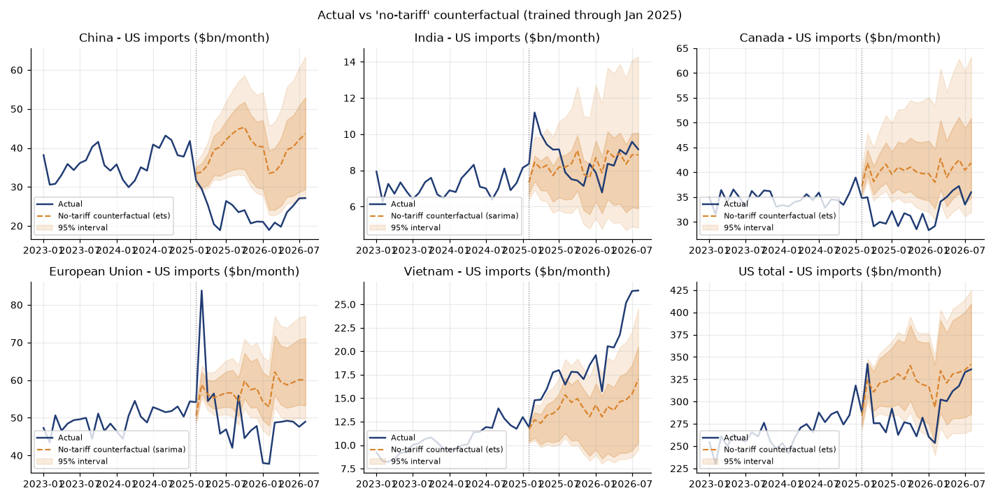
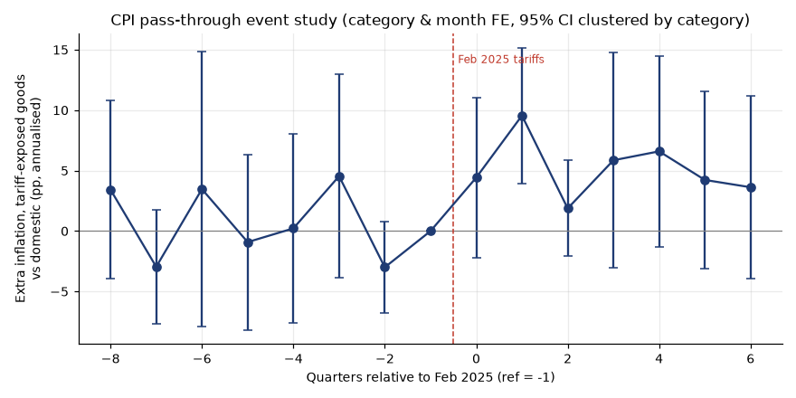
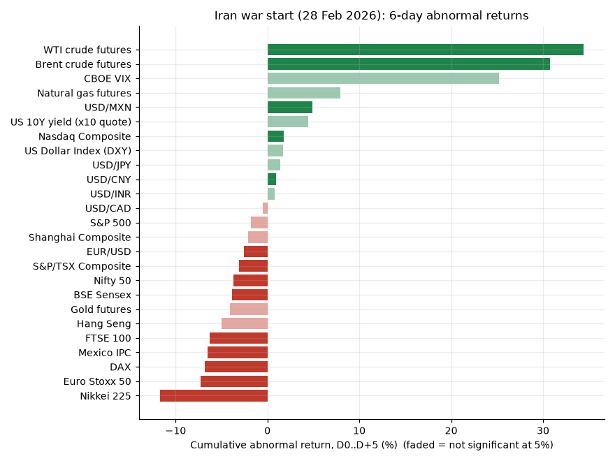
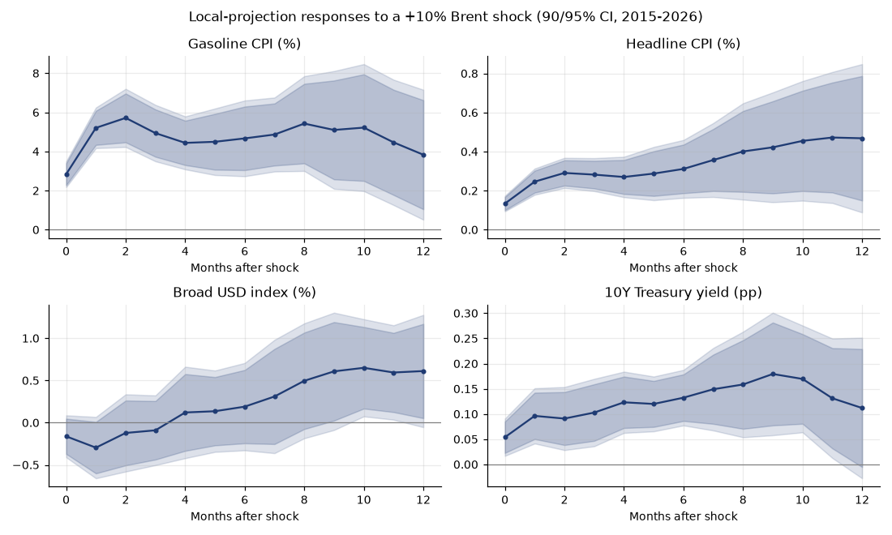
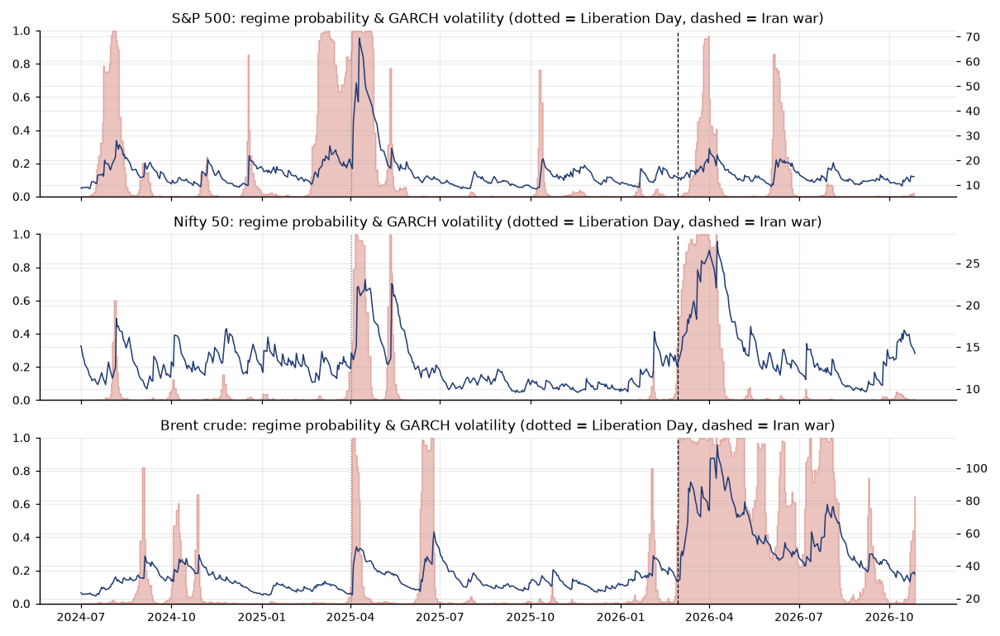
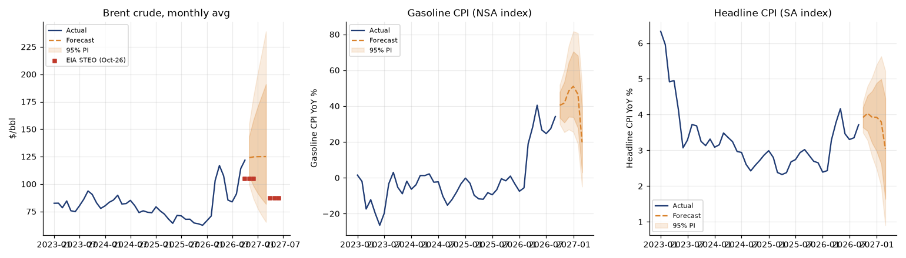

# ML & forecasting report - Tariffs, Oil & the American Wallet

_Generated 2026-10-27 19:50 IST by `python -m ml.run_all`. All numbers are read from the `ml` schema of `warehouse/tradewar.duckdb`._

## Plain-English findings

1. **China lost about 43% of its expected US sales.** From Apr 2025 to the latest month, US imports from China were
   $389bn, against a no-tariff counterfactual of $683bn. That is an effect of -$293bn
   (95% interval -$512bn to -$97bn).
2. **Trade was diverted, not just destroyed.** Taiwan ($167bn, +89%) and Vietnam
   ($89bn, +37%) sit well above their counterfactuals. Total US imports came in -$643bn (-11.6%)
   below the counterfactual, but the 95% interval (-$1,613bn to $266bn) includes zero, so the net effect on total imports is not clearly different from zero.
3. **Tariffs showed up in shelf prices.** After Feb 2025, tariff-exposed CPI goods inflated 3.8 pp a year faster than domestic goods and services
   (DiD, 95% CI 0.7 to 6.9 pp, p = 0.017). A placebo test with a fake Feb 2023 start finds no effect.
   A 1 pp rise in the effective tariff rate goes with roughly 0.22 pp higher YoY inflation in exposed categories (95% CI 0.12 to 0.31).
4. **The Iran war was a classic oil shock.** Over D0..D+5 Brent's abnormal return was +30.8% (t = 6.8).
   Over D0..D+20 the S&P 500's was -10.1% (t = -3.3). Historically, a +10% Brent month lifts gasoline CPI by 4.9% after 3 months (95% CI 3.5-6.4%)
   and headline CPI by 0.3% after 6 months.
5. **Outlook.** A random-walk-type ARIMA keeps Brent near current levels, about $123.6/bbl on average in Q4 2026 (Oct actual + Nov-Dec forecast), while EIA's Oct-2026 STEO has $105.
   A mean-reverting AR(1) alternative sits between the two. Headline CPI is projected at 3.9% YoY in Oct 2026
   and 3.0% in Mar 2027 (95% PI 0.9-5.2%).

## 1. Counterfactual 'no-tariff' trade (ml_trade_counterfactual, ml_trade_effect_summary)

**Method.** There are 20 series: imports and exports for China, Canada, Mexico, EU-27, India, Japan, Vietnam, Taiwan, South Korea and the US total.
Four candidates are compared:
- seasonal naive
- damped additive ETS on log levels
- SARIMA(1,1,1)(0,1,1)12 on log levels
- a global LightGBM on seasonal log-differences, with lags 1-3, 6 and 12, month, series id, a Covid flag, GSCPI and the lagged USD YoY, forecast recursively

Selection uses a rolling-origin backtest: 5 origins (Dec-2021 to Dec-2023) with a 12-month horizon, all pre-2025. The best model per series by mean WAPE
is refit on data through **Jan 2025** and projected forward. Prediction intervals come from the empirical quantiles of that model's backtest log-errors, scaled by sqrt(h).
Cumulative intervals add up the monthly bounds, which is conservative.

**Backtest, best model per series**

| series_id | model | wape | mape | smape |
|---|---|---|---|---|
| CAN\|exports | ets | 4.31 | 4.33 | 4.28 |
| CAN\|imports | ets | 6.60 | 6.50 | 6.57 |
| CHN\|exports | sarima | 7.81 | 7.89 | 7.95 |
| CHN\|imports | ets | 9.85 | 10.34 | 9.58 |
| EU27\|exports | ets | 6.02 | 5.97 | 6.14 |
| EU27\|imports | sarima | 4.87 | 4.82 | 4.84 |
| IND\|exports | ets | 9.96 | 9.97 | 9.94 |
| IND\|imports | sarima | 9.82 | 9.88 | 9.43 |
| JPN\|exports | ets | 5.86 | 5.77 | 5.79 |
| JPN\|imports | ets | 7.09 | 7.07 | 7.24 |
| KOR\|exports | seasonal_naive | 10.13 | 10.40 | 10.16 |
| KOR\|imports | sarima | 7.28 | 7.29 | 7.25 |
| MEX\|exports | sarima | 6.76 | 6.71 | 6.77 |
| MEX\|imports | sarima | 4.37 | 4.29 | 4.46 |
| TOTAL\|exports | ets | 4.55 | 4.52 | 4.57 |
| TOTAL\|imports | ets | 5.37 | 5.35 | 5.32 |
| TWN\|exports | lightgbm | 9.28 | 9.24 | 9.21 |
| TWN\|imports | lightgbm | 9.95 | 9.66 | 10.08 |
| VNM\|exports | ets | 16.87 | 15.94 | 15.96 |
| VNM\|imports | ets | 12.54 | 12.94 | 11.85 |

**Mean backtest error by model (all series)**

| model | wape | mape | smape |
|---|---|---|---|
| ets | 8.49 | 8.48 | 8.38 |
| sarima | 8.53 | 8.58 | 8.38 |
| seasonal_naive | 10.48 | 10.41 | 10.69 |
| lightgbm | 11.22 | 11.20 | 11.70 |

**Tariff effect, Apr 2025 to latest month (actual - counterfactual)**

| series | model | months | actual | counterfactual | effect | effect % | 95% interval | 80% interval | sig. 95% |
|---|---|---|---|---|---|---|---|---|---|
| CHN\|imports | ets | 17 | $389bn | $683bn | -$293bn | -43.00 | -$512bn to -$97bn | -$399bn to -$122bn | True |
| IND\|imports | sarima | 17 | $144bn | $143bn | $1bn | 1.00 | -$60bn to $53bn | -$13bn to $38bn | False |
| CAN\|imports | ets | 17 | $543bn | $687bn | -$144bn | -21.00 | -$392bn to -$20bn | -$251bn to -$57bn | True |
| EU27\|imports | sarima | 17 | $809bn | $977bn | -$169bn | -17.20 | -$369bn to -$40bn | -$300bn to -$85bn | True |
| MEX\|imports | sarima | 17 | $822bn | $802bn | $21bn | 2.60 | -$218bn to $60bn | -$100bn to $49bn | False |
| VNM\|imports | ets | 17 | $330bn | $242bn | $89bn | 36.60 | $12bn to $174bn | $52bn to $164bn | True |
| TWN\|imports | lightgbm | 17 | $354bn | $188bn | $167bn | 88.80 | $59bn to $208bn | $96bn to $192bn | True |
| TOTAL\|imports | ets | 17 | $4,882bn | $5,525bn | -$643bn | -11.60 | -$1,613bn to $266bn | -$1,444bn to $37bn | False |
| CHN\|exports | sarima | 17 | $148bn | $185bn | -$37bn | -19.80 | -$133bn to -$3bn | -$77bn to -$16bn | True |
| TOTAL\|exports | ets | 17 | $3,298bn | $3,006bn | $292bn | 9.70 | -$381bn to $619bn | -$125bn to $554bn | False |

## 2. CPI pass-through (ml_cpi_passthrough)

**Method.** The panel is BLS CPI categories (NSA). Each category is de-seasonalised by removing its 2017-2024 calendar-month mean, and the outcome is the monthly log change (pp).
- Treated: 13 tariff-exposed goods (apparel, footwear, furniture, appliances, new vehicles, computers, toys, coffee and others).
- Control: domestic services and used cars.
- Excluded: energy, food and airline fares, because the 2026 oil shock would contaminate them.

The regression has category and month fixed effects, with SEs clustered by category (or by month as a check).

| spec | term | coef | ci_lo | ci_hi | p_value | annualised_coef | n_obs |
|---|---|---|---|---|---|---|---|
| did_main | treat_post | 0.32 | 0.06 | 0.58 | 0.02 | 3.80 | 954 |
| did_cluster_month | treat_post | 0.32 | 0.09 | 0.54 | 0.01 | 3.80 | 954 |
| did_control_incl_food | treat_post | 0.34 | 0.09 | 0.59 | 0.01 | 4.11 | 1010 |
| did_post_liberation_day | treat_post | 0.33 | 0.06 | 0.60 | 0.02 | 3.95 | 954 |
| did_2019_start_ex_covid | treat_post | 0.33 | 0.09 | 0.57 | 0.01 | 3.99 | 1192 |
| placebo_post_feb2023 | treat_post | -0.22 | -0.57 | 0.12 | 0.21 | -2.67 | 816 |
| intensity_treated | d12_tariff_l3 | 0.22 | 0.12 | 0.31 | 0.00 |  | 1144 |
| intensity_treated | imp_px_yoy | 0.83 | 0.67 | 0.99 | 0.00 |  | 1144 |
| intensity_control_falsification | d12_tariff_l3 | -0.15 | -0.28 | -0.03 | 0.02 |  | 624 |
| intensity_control_falsification | imp_px_yoy | 0.54 | 0.36 | 0.71 | 0.00 |  | 624 |

**Reading.** Before Feb 2025 the event-study coefficients bounce around zero and none is significant, so there is no clear pre-trend. The largest effect is in the
second quarter after the tariffs began, which is Liberation Day and the 145% China peak. In the falsification test, domestic categories show a *negative* tariff
coefficient. That points to common shocks, such as services disinflation, loading onto the tariff-rate variable, so read the intensity coefficient as an association, not a causal elasticity.

## 3. Oil shock: event study (ml_event_study) and local projections (ml_irf)

**Method.**
- Equity indices: market model vs the S&P 500.
- The S&P 500, FX, commodities, VIX and ^TNX: constant-mean model.
- War events share one pre-war estimation window (2 Jun 2025 to 30 Jan 2026). Tariff events use [t0-280, t0-30] trading days.
- CAR t = CAR / (sigma * sqrt(L)).

**Iran war start (W02, t0 = first trading day on or after 28 Feb 2026)**

| symbol | instrument_name | car_pct D+20 | car_pct D+5 | t_stat D+20 | t_stat D+5 |
|---|---|---|---|---|---|
| 000001.SS | Shanghai Composite | -7.29 | -2.13 | -2.35 | -1.28 |
| BZ=F | Brent crude futures | 42.96 | 30.78 | 5.06 | 6.78 |
| CAD=X | USD/CAD | 1.83 | -0.48 | 1.49 | -0.73 |
| CL=F | WTI crude futures | 41.99 | 34.40 | 4.63 | 7.10 |
| CNY=X | USD/CNY | 1.47 | 0.94 | 2.26 | 2.70 |
| DX-Y.NYB | US Dollar Index (DXY) | 3.23 | 1.68 | 1.85 | 1.80 |
| EURUSD=X | EUR/USD | -3.31 | -2.58 | -1.83 | -2.67 |
| GC=F | Gold futures | -19.35 | -4.09 | -2.63 | -1.04 |
| INR=X | USD/INR | 3.20 | 0.77 | 2.52 | 1.13 |
| JPY=X | USD/JPY | 2.00 | 1.41 | 0.80 | 1.06 |
| MXN=X | USD/MXN | 6.79 | 4.91 | 3.87 | 5.24 |
| NG=F | Natural gas futures | -1.93 | 7.91 | -0.06 | 0.44 |
| ^BSESN | BSE Sensex | -10.11 | -3.84 | -4.16 | -2.95 |
| ^FTSE | FTSE 100 | -6.60 | -6.32 | -3.22 | -5.76 |
| ^GDAXI | DAX | -6.11 | -6.83 | -1.88 | -3.94 |
| ^GSPC | S&P 500 | -10.10 | -1.78 | -3.28 | -1.09 |
| ^GSPTSE | S&P/TSX Composite | -3.72 | -3.08 | -1.45 | -2.24 |
| ^HSI | Hang Seng | -7.47 | -4.97 | -1.53 | -1.91 |
| ^IXIC | Nasdaq Composite | 2.10 | 1.74 | 1.61 | 2.50 |
| ^MXX | Mexico IPC | -3.21 | -6.50 | -0.84 | -3.17 |
| ^N225 | Nikkei 225 | -16.93 | -11.71 | -3.00 | -3.88 |
| ^NSEI | Nifty 50 | -10.12 | -3.71 | -4.11 | -2.81 |
| ^STOXX50E | Euro Stoxx 50 | -7.03 | -7.29 | -2.27 | -4.40 |
| ^TNX | US 10Y yield (x10 quote) | 9.66 | 4.44 | 2.23 | 1.92 |
| ^VIX | CBOE VIX | 44.05 | 25.22 | 1.38 | 1.47 |

**Liberation Day (T05) - equity indices, D0..D+5 CAR %**

| instrument_name | car_pct | t_stat |
|---|---|---|
| Shanghai Composite | -3.95 | -1.30 |
| BSE Sensex | -2.33 | -1.08 |
| FTSE 100 | -11.16 | -7.98 |
| DAX | -12.70 | -7.26 |
| S&P 500 | -3.66 | -1.85 |
| S&P/TSX Composite | -3.69 | -3.27 |
| Hang Seng | -12.10 | -3.18 |
| Nasdaq Composite | 2.59 | 3.06 |
| Mexico IPC | -0.05 | -0.02 |
| Nikkei 225 | -9.67 | -2.44 |
| Nifty 50 | -2.81 | -1.30 |
| Euro Stoxx 50 | -12.68 | -6.29 |

**Local projections (2015-2026, monthly, HAC SEs): response to a +10% Brent month**

| outcome_label | horizon_months | irf | ci_lo95 | ci_hi95 |
|---|---|---|---|---|
| Gasoline CPI (%) | 0 | 2.84 | 2.18 | 3.50 |
| Gasoline CPI (%) | 3 | 4.94 | 3.50 | 6.38 |
| Gasoline CPI (%) | 6 | 4.67 | 2.73 | 6.61 |
| Gasoline CPI (%) | 12 | 3.83 | 0.51 | 7.16 |
| Headline CPI (%) | 0 | 0.13 | 0.09 | 0.17 |
| Headline CPI (%) | 3 | 0.28 | 0.20 | 0.37 |
| Headline CPI (%) | 6 | 0.31 | 0.16 | 0.46 |
| Headline CPI (%) | 12 | 0.47 | 0.09 | 0.85 |
| 10Y Treasury yield (pp) | 0 | 0.05 | 0.02 | 0.09 |
| 10Y Treasury yield (pp) | 3 | 0.10 | 0.04 | 0.17 |
| 10Y Treasury yield (pp) | 6 | 0.13 | 0.08 | 0.19 |
| 10Y Treasury yield (pp) | 12 | 0.11 | -0.03 | 0.25 |
| Broad USD index (%) | 0 | -0.16 | -0.41 | 0.09 |
| Broad USD index (%) | 3 | -0.09 | -0.50 | 0.32 |
| Broad USD index (%) | 6 | 0.19 | -0.33 | 0.71 |
| Broad USD index (%) | 12 | 0.61 | -0.05 | 1.28 |

## 4. Volatility regimes (ml_vol_regimes)

The models are a 2-state Markov-switching mean/variance model on daily % returns (2018 onward) and a GARCH(1,1) with Student-t errors.

| series_id | aic | calm_vol_ann_pct | expected_high_regime_days | garch_aic | garch_alpha | garch_beta | high_vol_ann_pct |
|---|---|---|---|---|---|---|---|
| BZ=F | 9,800.58 | 26.77 | 8.96 | 9,619.20 | 0.10 | 0.88 | 82.78 |
| ^GSPC | 6,200.37 | 11.30 | 17.86 | 5,956.07 | 0.16 | 0.82 | 33.14 |
| ^NSEI | 5,668.15 | 11.77 | 8.14 | 5,520.52 | 0.10 | 0.86 | 38.64 |

**Share of trading days in the high-vol regime, by war phase (Jun 2025 onward)**

| symbol | Ceasefire & blockade | Pre-war | Truce collapse & renewed blockade | War & Hormuz closure |
|---|---|---|---|---|
| BZ=F | 0.79 | 0.05 | 0.35 | 1.00 |
| ^GSPC | 0.11 | 0.01 | 0.00 | 0.27 |
| ^NSEI | 0.03 | 0.00 | 0.00 | 1.00 |

## 5. Forward forecasts (ml_forecasts)

- **Brent:** ARIMA(1,1,0) on log monthly average (primary), with a mean-reverting AR(1) alternative. EIA STEO (6 Oct 2026) reference: 4Q26 $105/b, 2Q27 $87/b, 2027 average $84/b.
- **Gasoline CPI and headline CPI:** SARIMAX with log Brent as an exogenous variable. Their intervals are *conditional* on the Brent point path, so they understate the true uncertainty.

| target | model | month_date | value | lo80 | hi80 | lo95 | hi95 | yoy_value |
|---|---|---|---|---|---|---|---|---|
| brent | ARIMA(1,1,0) log | 2026-11-01 00:00:00 | 124.09 | 107.27 | 143.56 | 99.31 | 155.07 |  |
| brent | ARIMA(1,1,0) log | 2026-12-01 00:00:00 | 124.77 | 98.37 | 158.24 | 86.74 | 179.46 |  |
| brent | ARIMA(1,1,0) log | 2027-01-01 00:00:00 | 124.96 | 91.60 | 170.48 | 77.71 | 200.95 |  |
| brent | ARIMA(1,1,0) log | 2027-02-01 00:00:00 | 125.02 | 86.24 | 181.23 | 70.85 | 220.60 |  |
| brent | ARIMA(1,1,0) log | 2027-03-01 00:00:00 | 125.03 | 81.83 | 191.04 | 65.39 | 239.10 |  |
| brent | AR(1) mean-reverting log | 2026-11-01 00:00:00 | 117.23 | 100.90 | 136.19 | 93.20 | 147.45 |  |
| brent | AR(1) mean-reverting log | 2026-12-01 00:00:00 | 113.11 | 92.11 | 138.90 | 82.62 | 154.85 |  |
| brent | AR(1) mean-reverting log | 2027-01-01 00:00:00 | 109.39 | 85.72 | 139.58 | 75.34 | 158.81 |  |
| brent | AR(1) mean-reverting log | 2027-02-01 00:00:00 | 106.01 | 80.69 | 139.29 | 69.83 | 160.95 |  |
| brent | AR(1) mean-reverting log | 2027-03-01 00:00:00 | 102.95 | 76.56 | 138.45 | 65.45 | 161.95 |  |
| gas | SARIMAX(1, 1, 0)(1, 0, 0) + log Brent | 2026-10-01 00:00:00 | 389.07 | 369.90 | 409.25 | 360.13 | 420.35 | 0.40 |
| gas | SARIMAX(1, 1, 0)(1, 0, 0) + log Brent | 2026-11-01 00:00:00 | 391.20 | 361.25 | 423.63 | 346.34 | 441.87 | 0.42 |
| gas | SARIMAX(1, 1, 0)(1, 0, 0) + log Brent | 2026-12-01 00:00:00 | 388.16 | 350.47 | 429.90 | 332.03 | 453.78 | 0.48 |
| gas | SARIMAX(1, 1, 0)(1, 0, 0) + log Brent | 2027-01-01 00:00:00 | 384.92 | 341.13 | 434.32 | 320.00 | 463.00 | 0.51 |
| gas | SARIMAX(1, 1, 0)(1, 0, 0) + log Brent | 2027-02-01 00:00:00 | 385.98 | 336.58 | 442.63 | 313.04 | 475.91 | 0.47 |
| gas | SARIMAX(1, 1, 0)(1, 0, 0) + log Brent | 2027-03-01 00:00:00 | 394.07 | 338.70 | 458.49 | 312.61 | 496.76 | 0.20 |
| headline_cpi | SARIMAX(1, 1, 1) + log Brent | 2026-10-01 00:00:00 | 337.38 | 336.48 | 338.29 | 336.00 | 338.77 | 0.04 |
| headline_cpi | SARIMAX(1, 1, 1) + log Brent | 2026-11-01 00:00:00 | 338.19 | 336.58 | 339.80 | 335.73 | 340.66 | 0.04 |
| headline_cpi | SARIMAX(1, 1, 1) + log Brent | 2026-12-01 00:00:00 | 338.84 | 336.51 | 341.20 | 335.27 | 342.45 | 0.04 |
| headline_cpi | SARIMAX(1, 1, 1) + log Brent | 2027-01-01 00:00:00 | 339.41 | 336.32 | 342.53 | 334.69 | 344.19 | 0.04 |
| headline_cpi | SARIMAX(1, 1, 1) + log Brent | 2027-02-01 00:00:00 | 339.90 | 336.05 | 343.81 | 334.02 | 345.89 | 0.04 |
| headline_cpi | SARIMAX(1, 1, 1) + log Brent | 2027-03-01 00:00:00 | 340.34 | 335.71 | 345.03 | 333.29 | 347.54 | 0.03 |

## Limitations (read before quoting)

- **Short post-period:** 17-19 months of tariffs and 8 months of war. Counterfactuals 12-19 months out sit at the edge of what the backtest covers.
- **Confounders:**
  - Front-loading in Q1 2025.
  - The AI and semiconductor import boom, which drives Taiwan and is not a tariff effect.
  - The USD decline and Section 232 sector tariffs.
  - The Oct-2025 federal shutdown gap in CPI data.
  - From Mar 2026, the war overlaps the tariff period, so CPI effects after that date mix both shocks.
- **Headline tariff rates** are statutory. Exemptions (USMCA, Annex II, Section 232 stacking) mean the effective rate is lower; see SQL query 14.
- The DiD assumes parallel trends between exposed goods and domestic categories. Pre-period coefficients support this but are noisy (13 vs 7 categories).
- Event-study t-stats assume i.i.d. abnormal returns. Overlapping war events (Hormuz closure, IEA release) blur the windows.
- Forecasts are statistical baselines, not structural oil-market models.

## Reproducibility

`python -m ml.run_all` runs after `dbt build`. Experiment logs are in `ml/experiments/*.json`. Runtime on a 2-core laptop: trade_counterfactual 139s, cpi_passthrough 1s, oil_shock 5s, vol_regimes 12s, forecasts 8s, total 166s.
